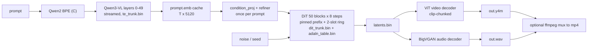

# FastH3-in-C Implementation Plan

> **For agentic workers:** REQUIRED SUB-SKILL: Use superpowers:subagent-driven-development (recommended) or superpowers:executing-plans to implement this plan task-by-task. Steps use checkbox (`- [ ]`) syntax for tracking.

**Goal:** A dependency-free C99 engine (`fh3`) that runs FastH3-8-Step-V2 (35B MiniMax-H3, text → synchronized video + stereo audio) on this laptop's CPU. It keeps the weights on the NVMe drive and pulls in only the parts each phase needs, the same way `kimi-k3-in-c` does.

**Architecture:** There are three phases that run one after another and never sit in memory together: **(1)** Qwen3-VL text encoder, layers 0–49 only. **(2)** The 50-block diffusion transformer (DiT), streamed from a packed trunk file through a *pinned prefix + 2-slot ring* for 8 denoising steps. **(3)** The video ViT-VAE decoder and the BigVGAN audio decoder, chunked by clip. Weights are repacked once into contiguous, 4096-aligned per-layer runs. AdaLN projections that depend only on the timestep are folded offline into a small exact table, which removes 37% of the DiT weights from the hot path.

**Tech Stack:** C99 + OpenMP + libm (GCC/MinGW-w64 on Windows, GCC/Clang on Linux), CMake + CTest. Python 3.11 (numpy, `gguf`, torch-cpu, diffusers@main) is used **only** in `tools/` for packing, fixtures and reference checks, never at runtime.

**Spec:** This document (sections "What the model is" and "Reduction ledger") plus the user request: *recreate https://huggingface.co/realrebelai/FastH3-V2_GGUFs in the form of https://github.com/FareedKhan-dev/kimi-k3-in-c: model stays on disk, only the needed part is used.*

---

## What the model is (measured, not guessed)

These facts come from the live repos on 2026-11-10: the GGUF header was parsed via an HTTP range read, and the configs were fetched from `FastVideo/FastVideo-FastH3-8-Step-V2` and diffusers `main`.

| Item | Value |
|---|---|
| DiT | `MiniMaxH3Transformer3DModel`: 50 blocks + 2 token-refiner blocks, hidden 5376, 56 heads × 128, FFN 14336 (SwiGLU), patch (1,2,2) |
| Sequence | **One packed 1-D sequence** `[text \| audio \| video]` with full self-attention. No cross-attention, no MoE. Each row has a modality tag 0=video, 1=text, 2=audio |
| AdaLN | Per block `adaln_proj.linear`: 2688 → 96768 (= 6 × 5376 × 3 modalities). Its input is **only the timestep embedding** |
| Steps | DMD2-distilled, **8 forwards**, fixed `dmd_denoising_steps = [999,874,749,624,500,375,250,125]`, video shift 10, audio shift 3, guidance 1.0 (no negative branch) |
| Attention | Trained with VSA-H3 sparse attention, 80% sparsity, tile 64 (`to_gate_compress` weights present) |
| GGUF Q4_K_M | 19.84 GB, 585 tensors, `general.architecture = "wan"` (a ComfyUI loader label). Types: Q4_K 19.67 GB, F16 0.15 GB, F32 0.02 GB |
| Per block (Q4_K) | qkv 65.0 MB + gate_compress 21.7 + out 21.7 + fc1 86.7 + fc2 43.4 = **238.4 MB**, plus **adaln 146.3 MB** |
| GGUF layout quirk | All 52 `qkv_proj` tensors sit at the **front** of the file (0–3.38 GB), away from their blocks, so a block is *not* contiguous. Some tensors are stored reshaped, and their real shape is in `comfy.gguf.orig_shape.*` KVs |
| Text encoder | Qwen3-VL-32B (64 layers, hidden 5120, GQA 64/8). H3 reads **`hidden_states[50]`**, so layers 50–63, final norm, LM head and the whole vision tower are never used. Prompt goes in verbatim with no special tokens |
| Video VAE | Causal-conv encoder + **ViT decoder** (36 layers, 32×64 heads). Latent 24 ch, 16× spatial, `17n+5` frames → `5n+2` latent frames. Only the decoder is needed |
| Audio VAE | DAC-style encoder + **BigVGAN decoder**, 32 kHz, 32 latent ch, 800× upsampling. Only the decoder is needed |
| This machine | i5-13420H (4P+4E, AVX2/FMA), **15.7 GB RAM**, Samsung NVMe 512 GB (**111 GB free**), RTX 3050 4 GB. **No C compiler installed yet** |

## Why Kimi's trick has to change here

Kimi gets its savings from MoE: only 16 of 896 experts fire per token, so most of the model never loads. **FastH3 is dense.** Every token goes through every block on every step, so there are no sleeping experts to skip. What *can* be skipped:

1. **AdaLN folding (exact):** 13 B of the 35 B parameters (7.32 GB at Q4_K) only map *timestep → modulation vectors*. The 8 timesteps are fixed, so we compute every needed vector once and store a ≈0.16 GB table. The 7.32 GB never has to be read again.
2. **Run-once parts:** `condition_proj` + token refiner depend only on the prompt, so they run once per prompt instead of 8 times.
3. **Truncated text encoder:** layers 0–49 only. Embedding rows are read per token id (≈3 KB each) instead of loading the 0.4 GB table.
4. **Decoder-only VAEs:** both VAE encoders are dropped.
5. **Phase isolation:** text encoder, then DiT, then VAEs. Peak RAM is the *max* of the phases, not their sum.
6. **Trunk streaming (same as Kimi):** pinned prefix + ring, never LRU. Each step is a cyclic scan over 50 blocks, which is exactly where LRU hit rate drops to zero.

> [!IMPORTANT]
> Diffusion is **compute-bound**, not disk-bound. One step streams about 12 GB, which takes ~4 s on this NVMe, but the math for ~900 rows × 21 B params takes minutes. Streaming makes the model *fit*. It does not make it *fast*. The honest speed numbers are in the "Expected performance" section below.

## Reduction ledger (targets; Task 2 replaces these with exact census numbers)

| Stage | DiT bytes touched per step |
|---|---|
| Official BF16 transformer | 70.10 GB |
| realrebelai Q4_K_M GGUF (as shipped) | 19.84 GB |
| − AdaLN folded into table (exact for the fixed 8-step schedule) | 12.52 GB |
| − refiner/condition_proj/time-embedder run once or folded | **≈ 11.92 GB** (50 × 238.4 MB) |
| RAM floor for DiT phase (2 ring slots + activations, tiny preset) | **≈ 1.5 GB** |
| Default on this laptop (`--mem-gb 9`) | ~30 of 50 blocks pinned, ~4.8 GB read per step |



## Decisions to confirm (defaults in **bold**; the plan is written for the defaults)

| # | Decision | Options |
|---|---|---|
| D1 | Compute target | **CPU-only pure C like Kimi**; CUDA ring-slot backend for the RTX 3050 becomes a separate follow-up plan (Phase 7) |
| D2 | Scope | **Full text→video+audio in C** (one binary) vs DiT-only in C with Python for the text encoder/VAEs |
| D3 | AdaLN fold source | **From the GGUF's Q4_K weights** (matches the model you picked) vs BF16 weights range-fetched from FastVideo (higher fidelity, ~26 GB transient download, nothing stored) |
| D4 | Attention | **VSA-H3 sparse (what it was trained with)**, with `--dense-attn` as a debug fallback |
| D5 | Quants supported | **Q4_K_M default; Q3_K_M/Q5_K_M also load** (kernels for Q2_K–Q6_K, F16, BF16, F32) |

## Global Constraints

- Language: C99 (`-std=gnu99`), only libm + OpenMP at runtime. No BLAS, no PyTorch, no ONNX, no GPU library in Phases 0–6.
- Flags: `-O3 -Wall -Wextra -Wshadow -Wvla -Werror -march=native -fopenmp -ffp-contract=off`. Scalar, OpenMP and AVX2 paths must give **bit-identical** output.
- Platforms: Windows 11 x64 (MinGW-w64 GCC ≥ 13 with OpenMP) and Linux x86-64/ARM64.
- Model source of truth: `realrebelai/FastH3-V2_GGUFs` file `FastH3-8-Step-V2-Q4_K_M.gguf` (sha256 `88a727ee4e32cd86af6b457ba64ed394deaf4cfd69857c669ee977667e62f5a9`), text encoder `Text Encoders/qwen3vl-32B-MiniMax-H3-Q4_K_M.gguf` (sha256 `1bf75e038c5895b97b6ea16cc1e3d32076254b06ec3df10657650d86dc82279e`), VAEs from `FastVideo/FastVideo-FastH3-8-Step-V2` `vae/` and `audio_vae/`.
- Numerical reference: diffusers `main` (`transformer_minimax_h3.py`, `scheduling_minimax_h3.py`, `autoencoder_kl_minimax_h3*.py`, `modular_pipelines/minimax_h3/*`) and FastVideo commit `24bbe7fddd05ca6f2c34b3dbed06ac1c75b72086` (VSA-H3, DMD sampler). Pin the diffusers commit SHA in `tools/requirements.lock` on day 1.
- All packed files: 4096-byte aligned per layer, little-endian, with a header holding magic `FH3P`, version, source sha256 and a layer table.
- Memory: add up every allocation **before** allocating, compare against available physical RAM × 0.95, and refuse to start with a shortfall message.
- Disk budget: everything under `models/` + `packed/` must stay ≤ 60 GB (111 GB free today).
- License: weights are under the MiniMax H3 Community License. Never commit weights; keep `NOTICE` crediting MiniMax, FastVideo, realrebelai, and Fareed Khan's design.

## Invariants (each one is gated by a fixture that fails if it is gotten wrong)

1. **AdaLN rows are addressed by `timestep_index*3 + modality`** (0 video, 1 text, 2 audio). Chunk order: `shift_msa, scale_msa, gate_msa, shift_mlp, scale_mlp, gate_mlp`. Modulate is `x*(1+scale)+shift`. SiLU is applied to `temb` *before* the linear.
2. **Text conditioning = `hidden_states[50]` = output of decoder layer 49 (0-based), before the final norm.** Truncating the stack to 50 layers and taking its normed output is wrong.
3. **Velocity is data-ward:** `x0 = x_t + sigma*v`, `t = 1 - sigma`, timesteps go into the time embedder unscaled in [0,1].
4. **RoPE rotates only 2·3·16 = 96 of 128 head channels** (rotate-half convention). Positions are 3-axis and computed in fp64 before the cos/sin cast.
5. **GGUF `comfy.gguf.orig_shape.*` overrides the stored dims.** `general.architecture="wan"` is a label, so the model is detected by tensor names (`blocks.0.attn.to_gate_compress.weight`, 50 `blocks.N`).

## Review Focus

1. **Unsupported resolution/frame count** (e.g. 500×300, 30 frames): snap up to multiples of 32 px and `17n+5` frames, plus VSA tile padding. Print the resolved size. Never crash and never misalign silently. → test in Task 17.
2. **Not enough RAM or disk at start** (e.g. `--mem-gb 0.5`): refuse with the exact shortfall and exit code 3 before allocating anything. → tests in Task 8 and Task 17.
3. **Truncated or wrong GGUF** (interrupted download, Q5 file passed as Q4): header/size/sha check, then a clear error and exit code 4. → tests in Task 4 and Task 17.
4. **Non-ASCII and long prompts** (CJK, emoji, 600 tokens): tokenizer parity with HF and `--prompt-file` input. → test in Task 13.
5. **Ctrl-C mid-denoise**: exit cleanly, keep the per-step `latents.step<k>.bin`, and resume with `--resume`. → test in Task 17.
6. **Folded table not matching the schedule** (someone changes steps/shift): the table header stores a hash of `(dmd_steps, shifts)`, and the engine refuses on mismatch. → test in Task 7.

---

## File Structure

```
FASTH3INC/
  CMakeLists.txt                # targets: fh3, test_* ; ctest
  include/fh3/fh3.h             # public types: Fh3DitCfg, Fh3TeCfg, Fh3W, kernel prototypes
  include/fh3/fh3_cfg.h         # header-only JSON config reader, refuses defaults
  src/io/fh3_portable_io.h      # unbuffered/direct IO, aligned alloc, mem-available (Win32 + POSIX)
  src/io/fh3_gguf.c/.h          # GGUF v3 reader (KV + tensor table), orig_shape support
  src/io/fh3_pack.c/.h          # packed-file (FH3P) reader: header, layer table, tensor views
  src/io/fh3_trunk.c/.h         # pinned prefix + 2-slot ring streamer with async prefetch
  src/core/fh3_quant.c          # dequant rows: F32 F16 BF16 Q8_0 Q2_K Q3_K Q4_K Q5_K Q6_K
  src/core/fh3_ops.c            # matmul, rmsnorm, rope3, swiglu, attention, modulate, conv1d/3d helpers
  src/core/fh3_vsa.c            # VSA-H3 sparse attention
  src/model/fh3_dit.c/.h        # DiT forward (refiner once, 50 blocks, heads)
  src/model/fh3_seq.c/.h        # packed-sequence builder: tags, 3-axis positions, timestep indices
  src/model/fh3_sched.c/.h      # DMD 8-step schedule, x0/renoise, RNG
  src/model/fh3_te.c/.h         # Qwen3 text decoder, stop at layer 50
  src/tokenizer/fh3_tok.c/.h    # Qwen2 byte-level BPE
  src/vae/fh3_vae_video.c/.h    # ViT decoder + clip chunking
  src/vae/fh3_vae_audio.c/.h    # BigVGAN decoder
  src/out/fh3_y4m.c fh3_wav.c   # writers
  src/cli/fh3_run.c             # `fh3` binary: plan, phases, report
  tools/                        # python only: census, fetch, pack, fold, fixtures, references
  tests/unit/*.c  tests/fixtures/*
  docs/ARCHITECTURE.md  docs/superpowers/plans/
  models/  packed/  out/        # git-ignored
```

---

## Phase 0: Toolchain, census, reference

### Task 1: Toolchain + repo skeleton

**Files:** Create `CMakeLists.txt`, `.gitignore`, `include/fh3/fh3.h` (empty types), `tests/unit/test_smoke.c`, `tools/requirements.lock`, `NOTICE`, `README.md` (stub).

**Interfaces:** Produces the CMake targets `fh3_core` (static lib of `src/**`), `fh3` (CLI), `test_<name>` registered with `add_test`.

- [ ] **Step 1:** Install GCC with OpenMP + CMake: `winget install BrechtSanders.WinLibs.POSIX.UCRT Kitware.CMake`. Verify `gcc --version` ≥ 13 and `echo '#include <omp.h>' | gcc -fopenmp -x c -E - >NUL` succeeds.
- [ ] **Step 2:** Python env with uv: `uv venv .venv --python 3.11` then `uv pip install numpy gguf safetensors requests torch --index-url ...cpu` + `diffusers @ git+https://github.com/huggingface/diffusers@<sha>` `transformers`. Freeze into `tools/requirements.lock`.
- [ ] **Step 3:** Write `test_smoke.c`: asserts `omp_get_max_threads() >= 1` and `sizeof(void*) == 8`.
- [ ] **Step 4:** `cmake -S . -B build -G "MinGW Makefiles" && cmake --build build && ctest --test-dir build`. Expected: `100% tests passed`.
- [ ] **Step 5:** `git init`, commit `chore: skeleton + toolchain`.

### Task 2: Remote census + selective fetch (Python)

**Files:** Create `tools/hf_range.py`, `tools/gguf_remote.py`, `tools/census.py`, `tests/py/test_census.py`.

**Interfaces:**
- `hf_range.read(url: str, start: int, end: int) -> bytes` (HTTP `Range`, retries, resumable).
- `gguf_remote.header(url) -> GgufHeader{kv: dict, tensors: list[TensorInfo(name, dims, type, offset, nbytes)], data_offset: int}`. It grows the range read until the header parses.
- `census.py --dit URL --te URL` prints the per-group byte table, **AdaLN bytes**, **trunk bytes**, max block run and TE bytes for layers <50 vs ≥50, then writes `docs/data/census.json`.

- [ ] **Step 1:** Test: `test_header_parses_q4km` (network-marked) asserts `len(tensors)==585`, `kv["general.architecture"]=="wan"`, the sum of `blocks.*.adaln_proj.linear.weight` nbytes `== 50*146_313_216` (±0 bytes; take the exact value from the first run and pin it), and `blocks.0` non-adaln bytes ≈ 238.4 MB.
- [ ] **Step 2:** Implement. Reuse the struct layout from `scratch/parse_gguf.py` (already proven on this file).
- [ ] **Step 3:** Run `python tools/census.py ...`. Paste the output into README's ledger, replacing the ≈ values.
- [ ] **Step 4:** Commit `feat(tools): remote GGUF census`.

### Task 3: Reference transcription → `docs/ARCHITECTURE.md` (research gate)

**Files:** Create `docs/ARCHITECTURE.md`, `tools/ref/h3_ref.py` (numpy reference of one DiT block, refiner, final layer, sampler), `tools/ref/vsa_ref.py`.

**Interfaces:** `h3_ref.block(x, w: dict, mod: np.ndarray[N,6,5376], cos, sin, vsa: VsaCfg|None) -> np.ndarray`, `h3_ref.sampler_plan(dmd_steps, video_shift, audio_shift) -> list[StepPlan(sigma_v, sigma_v_next, sigma_a, sigma_a_next, unique_t, text_t)]`.

- [ ] **Step 1:** From FastVideo @`24bbe7f` (`examples/inference/basic/basic_fasth3_8step.py` and its pipeline/VSA backend), write down exactly: (a) how 999…125 map to video/audio sigmas under shifts 10/3; (b) the renoise rule and noise draw order; (c) which timestep text rows use; (d) the VSA-H3 algorithm: tile order, how text/audio rows are treated, the top-k rule at 80%, how `to_gate_compress` combines coarse and fine; (e) the sequence order `[text | audio | video]` and the fp64 position grid; (f) the SwiGLU half order.
- [ ] **Step 2:** Test `test_ref_matches_diffusers`: build diffusers `MiniMaxH3Transformer3DModel` with a tiny config (hidden 256, heads 2×128, layers 3, refiner 2, ffn 512, text_dim 64, temb 128) and random seed 0. `h3_ref` forward with dense attention must match torch with rel-L2 ≤ 1e-5.
- [ ] **Step 3:** Test `test_vsa_ref_matches_fastvideo`: if FastVideo's triton/torch reference VSA can run on CPU, compare `vsa_ref` against it on N=512 random q/k/v (rel-L2 ≤ 1e-5). Otherwise compare against FastVideo's pure-torch fallback and record which one in ARCHITECTURE.md.
- [ ] **Step 4:** Commit `docs: architecture + numpy reference`.

> [!WARNING]
> Task 3 is a **gate**. If FastVideo's VSA-H3 semantics can't be reproduced on CPU, stop and bring it back to the user. D4 then falls back to dense attention, which is off the training distribution and the quality impact is unknown.

---

## Phase 1: Engine foundation (C)

### Task 4: Portable IO + GGUF reader

**Files:** Create `src/io/fh3_portable_io.h`, `src/io/fh3_gguf.c/.h`, `tests/unit/test_gguf.c`, `tests/fixtures/gguf/tiny.gguf` (written by `tools/make_gguf_fixture.py` with gguf-py: 3 tensors F32/F16/Q4_K + one `comfy.gguf.orig_shape.x` KV).

**Interfaces:**
- `int fh3_open_direct(const char *path, Fh3File *f)`: `FILE_FLAG_NO_BUFFERING|FILE_FLAG_OVERLAPPED` on Win32, `O_DIRECT` (fallback buffered) on Linux.
- `int64_t fh3_pread(Fh3File *f, void *buf, size_t n, uint64_t off)`, `void *fh3_alloc_aligned(size_t n)` (4096), `uint64_t fh3_mem_available(void)` (`GlobalMemoryStatusEx.ullAvailPhys` / `MemAvailable`).
- `int fh3_gguf_open(const char *path, Fh3Gguf *g)`, `const Fh3Tensor *fh3_gguf_find(const Fh3Gguf *g, const char *name)`, `int fh3_gguf_shape(const Fh3Gguf *g, const Fh3Tensor *t, int64_t out[4])` (applies orig_shape), `void fh3_gguf_close(Fh3Gguf *g)`.
- `Fh3Tensor { char name[128]; int ndim; int64_t ne[4]; int type; uint64_t off; uint64_t nbytes; }`.

- [ ] **Step 1:** Tests: `gguf_reads_tiny` (3 tensors, names, types, offsets equal gguf-py's), `gguf_orig_shape_applies` (`x` reported as `[96,5376]` not stored dims), `gguf_truncated_refuses` (fixture cut at 60% → returns `FH3_E_TRUNCATED`), `gguf_bad_magic_refuses`.
- [ ] **Step 2:** Run → FAIL (undefined symbols).
- [ ] **Step 3:** Implement. Validate `data_off + max(off+nbytes) <= file_size` up front.
- [ ] **Step 4:** Run → PASS. Also run `fh3_gguf_open` on the real Q4_K_M header slice (`scratch/q4_head.bin` is a 16 MB prefix): the header must parse, and the size check must report *truncated* (correct, since it's a prefix).
- [ ] **Step 5:** Commit.

### Task 5: Quant dequant + weight-stationary matmul

**Files:** Create `src/core/fh3_quant.c`, part of `src/core/fh3_ops.c`, `tests/unit/test_quant.c`, `tests/unit/test_matmul.c`, `tools/emit_quant_fixtures.py`.

**Interfaces:**
- `size_t fh3_row_bytes(int type, int64_t n)`, `void fh3_dequant(int type, const void *src, float *dst, int64_t n)`.
- `Fh3W { int type; int64_t in, out; const uint8_t *data; }`.
- `void fh3_matmul(const Fh3W *w, const float *x, float *y, int n_tok, const float *bias_or_null)`: `y[n_tok][out] = x[n_tok][in] · Wᵀ + b`. Implementation: dequantize a tile of 64 output rows to f32 scratch once, then run it against **all** tokens (dequant cost amortized over the token count). Fixed reduction order. OpenMP over output tiles. Explicit AVX2 `_mm256_fmadd_ps` in an `#ifdef __AVX2__` path whose summation tree is identical to the scalar path's.

- [ ] **Step 1:** Fixture tool: for each type in {F16, BF16, Q8_0, Q2_K, Q3_K, Q4_K, Q5_K, Q6_K}, quantize 4×512 random values with gguf-py and store raw bytes plus gguf-py's `dequantize()` f32 output as JSON.
- [ ] **Step 2:** Tests: `dequant_<type>_bitexact` (memcmp == 0 vs gguf-py), `matmul_scalar_eq_avx2_eq_omp` (bitwise equal for in=5376, out=192, n_tok=37), `matmul_matches_numpy` (rel-L2 ≤ 1e-6 vs float64 numpy).
- [ ] **Step 3:** Run → FAIL. **Step 4:** Implement. **Step 5:** Run → PASS.
- [ ] **Step 6:** Add `benchmarks/bench_matmul.c`: report GFLOP/s for Q4_K in=5376 out=14336 n_tok=1024. Record it in `docs/data/speed.md`. **This number drives every time estimate.**
- [ ] **Step 7:** Commit.

### Task 6: Elementwise ops + dense attention

**Files:** Modify `src/core/fh3_ops.c`. Create `tests/unit/test_ops.c`, `tools/emit_fixtures.py` (from `h3_ref`).

**Interfaces:** `fh3_rmsnorm(float *x, const float *w, int n, int dim, float eps)`, `fh3_rope3(float *x, const float *cos, const float *sin, int n, int heads, int head_dim, int rot_dim /*96*/)`, `fh3_swiglu(const float *in, float *out, int n, int F)`, `fh3_modulate(float *x, const float *shift, const float *scale, int n, int dim)` (per-row pointers via index), `fh3_gate_residual(float *h, const float *gate, const float *y, int n, int dim)`, `fh3_attention(const float *q, const float *k, const float *v, float *o, int n, int heads, int hd)` (tiled online softmax, O(n·hd) memory), `fh3_timestep_embed(const double *t, int nt, int freq_dim, float *out)` (flip_sin_to_cos, shift 0; used by fixtures and the folder only).

- [ ] **Step 1:** Fixtures chosen so plausible bugs fail them: RoPE with rot_dim 128 must **fail** the 96-dim fixture; SwiGLU with swapped halves must fail; modulate with `x*scale+shift` must fail; attention at n=777 (not a tile multiple).
- [ ] **Step 2:** Tests: one per op, tolerance max-abs ≤ 1e-5·max(1,|ref|). Run → FAIL. Implement. Run → PASS.
- [ ] **Step 3:** Commit.

---

## Phase 2: Packing: keep it on the drive, take only what's needed

### Task 7: Pack the DiT trunk + fold AdaLN

**Files:** Create `tools/pack_dit.py`, `tools/fold_adaln.py`, `src/io/fh3_pack.c/.h`, `tests/unit/test_pack.c`, `tests/py/test_fold.py`.

**Interfaces:**
- `pack_dit.py --src <local .gguf | URL> --out packed/` writes:
  - `dit_trunk.bin`: header + 50 layer runs; each run = `[qkv, gate_compress, out, fc1, fc2, norm1, norm2, q_norm, k_norm]` in that order, each tensor 32-byte aligned, the run 4096-aligned. **No adaln.** Scatter-gather (unlike Kimi), because qkv lives at the file front.
  - `dit_globals.bin`: refiner (2 blocks), condition_proj, patch projections, output heads, final norm, rope inv_freq.
  - `adaln_table.bin`: from `fold_adaln.py`. Header `{magic, n_steps=8, n_blocks=50, pairs_per_step P, hidden=5376, schedule_hash}` + f32 `[step][block][pair][6][5376]` + final-layer `[step][pair][2][5376]`, with `pairs` = the exact `(unique_t, modality)` pairs the sequence addresses (from `h3_ref.sampler_plan`).
  - With a URL source, AdaLN weights are range-fetched **block by block into RAM, folded, and dropped**. 7.3 GB is never written to disk.
- C: `int fh3_pack_open(const char *path, Fh3Pack *p)`, `Fh3LayerView fh3_pack_layer(const Fh3Pack *p, int L, const uint8_t *base)` returning `Fh3W` for each tensor, `int fh3_adaln_open(const char *path, uint64_t expect_hash, Fh3Adaln *a)`, `const float *fh3_adaln_row(const Fh3Adaln *a, int step, int block, int pair, int chunk)`.

- [ ] **Step 1:** Python test `test_fold_matches_live_adaln`: for block 0 and 7, step 3, `table[...] == silu(temb(t)) @ W.T + b` computed live from the GGUF (bit-exact in f32 with the same op order).
- [ ] **Step 2:** C tests on a tiny packed fixture: `pack_layer_offsets_aligned` (every run % 4096 == 0), `pack_layer_tensor_bytes_match_gguf` (memcmp vs gguf slices), `adaln_hash_mismatch_refuses`.
- [ ] **Step 3:** Implement; run the real pack. Expected log: `wrote dit_trunk.bin: ~11.92 GB across 50 layers, largest run ~238.4 MB`, `adaln_table.bin ≈ 0.16 GB`.
- [ ] **Step 4:** Commit.

### Task 8: Trunk streamer (pinned prefix + 2-slot ring)

**Files:** Create `src/io/fh3_trunk.c/.h`, `tests/unit/test_trunk.c`.

**Interfaces:** `int fh3_trunk_open(const char *path, uint64_t budget_bytes, Fh3Trunk *t)` (fixed-point solve of pinned count vs slot size, as Kimi does), `const uint8_t *fh3_trunk_acquire(Fh3Trunk *t, int L)` (blocks until resident), `void fh3_trunk_prefetch(Fh3Trunk *t, int L)` (async: overlapped IO on Win32, pread worker thread on POSIX), `Fh3TrunkStats fh3_trunk_stats(const Fh3Trunk *t)` (`hits, misses, bytes_read, read_s, wait_s`). Plan: `uint64_t fh3_plan_bytes(const Fh3Plan *p)`, where `fh3_plan_check()` returns `FH3_E_NOMEM` (exit code 3) with a shortfall message.

- [ ] **Step 1:** Tests: `trunk_pinned_prefix_hit_rate` (10 layers, budget for 6 pinned + 2 slots, 3 cyclic scans → hits == 18, misses == 12, deterministic), `trunk_never_lru` (the same scan through a pure LRU of 8 would get 0 hits; assert ours > 0), `trunk_prefetch_overlaps` (`wait_s < read_s` with a sleep-injected compute), `plan_refuses_when_short` (`--mem-gb 0.5` → `FH3_E_NOMEM`, nothing allocated).
- [ ] **Step 2:** FAIL → implement → PASS. **Step 3:** Commit.

---

## Phase 3: DiT forward + denoise

### Task 9: Tiny oracle + DiT forward

**Files:** Create `tools/make_tiny_h3.py`, `tests/fixtures/tiny_h3/*`, `src/model/fh3_seq.c/.h`, `src/model/fh3_dit.c/.h`, `tests/unit/test_dit_tiny.c`.

**Interfaces:**
- `make_tiny_h3.py`: diffusers tiny model (Task 3 config, 3 blocks) → writes a **GGUF in realrebelai's tensor naming**, runs it through `pack_dit.py` + `fold_adaln.py`, and dumps inputs (text emb, noise, positions) and outputs (video_v, audio_v) for steps 0 and 7.
- `int fh3_seq_build(const Fh3SeqSpec *s, Fh3Seq *out)`: rows, tags, `pos[N][3]` (fp64 → cos/sin f32), `pair_index[N]`.
- `int fh3_dit_prepare_text(const Fh3Dit *m, const float *text_emb, int T, float *text_rows)`: condition_proj + refiner, **once**.
- `int fh3_dit_forward(const Fh3Dit *m, Fh3Trunk *tr, const Fh3Seq *seq, int step, const float *x_video, const float *x_audio, const float *text_rows, float *v_video, float *v_audio)`.

- [ ] **Step 1:** Tests: `dit_tiny_step0_matches_torch`, `dit_tiny_step7_matches_torch` (rel-L2 ≤ 1e-4, dense attention), `dit_tiny_streamed_eq_pinned` (budget for 1 pinned layer vs all pinned → bitwise identical outputs), `refiner_runs_once` (counter == 1 across 8 steps).
- [ ] **Step 2:** FAIL → implement → PASS. **Step 3:** Commit.

### Task 10: VSA-H3 in C

**Files:** Create `src/core/fh3_vsa.c`, `tests/unit/test_vsa.c`, fixtures from `vsa_ref.py`.

**Interfaces:** `void fh3_vsa_attention(const Fh3VsaCfg *c, const float *q, const float *k, const float *v, const float *gate, float *o, const Fh3Seq *seq)`, with `Fh3VsaCfg{ int tile /*64*/; float sparsity /*0.8*/; }`.

- [ ] **Step 1:** Tests: `vsa_matches_ref_n784` (tiny-preset grid 7×8×14), `vsa_matches_ref_padded` (grid not a tile multiple), `vsa_sparsity0_eq_dense_plus_coarse` (structural check), all at rel-L2 ≤ 1e-5.
- [ ] **Step 2:** FAIL → implement → PASS. Wire it into `fh3_dit_forward` behind `cfg.attn = FH3_ATTN_VSA` and re-run the Task 9 tests with VSA fixtures.
- [ ] **Step 3:** Commit.

### Task 11: Real-checkpoint conformance (all 50 blocks)

**Files:** Create `tools/conform_all.py`, `tests/unit/test_real_block.c` (CLI `test_real_block --pack packed/ --block L --in x.bin --out y.bin`), `tests/fixtures/gates/conform_all_50.log` (committed log, not weights).

- [ ] **Step 1:** `conform_all.py`: for L in 0..49, random x (N=256, seed L), numpy `h3_ref.block` with weights dequantized from the GGUF by gguf-py and modulation from the table. Run the C binary. Assert rel-L2 ≤ 1e-4 **and** a deliberately mis-bound check (feed block L's weights with block L+1's modulation) gives rel-L2 > 1e-2. A wrong binding misses by about 1, not 1e-6.
- [ ] **Step 2:** Run it. Expected: `50/50 blocks PASS`. Commit the log.

### Task 12: Sampler + noise parity

**Files:** Create `src/model/fh3_sched.c/.h`, `tests/unit/test_sched.c`.

**Interfaces:** `int fh3_sched_build(Fh3Sched *s, const int dmd[8], double video_shift, double audio_shift)`, `void fh3_sched_step(const Fh3Sched *s, int i, float *x, const float *v, int n, int modality, const float *noise_next)` (`x0 = x + sigma*v`, then renoise to the next sigma, or return x0 on the last step), `void fh3_rng_normal(uint64_t seed, uint64_t stream, float *out, size_t n)` (Philox4x32 for our own use). `--noise-in noise.bin` reads the reference's noise for parity.

- [ ] **Step 1:** Tests: `sched_sigmas_match_ref` (8 video + 8 audio sigmas vs `h3_ref.sampler_plan`, |Δ| ≤ 1e-12), `sched_last_step_returns_x0`, `tiny_denoise_8_steps_matches_torch` (Task 9 tiny model + reference noise → final latents rel-L2 ≤ 1e-4).
- [ ] **Step 2:** FAIL → implement → PASS. **Step 3:** Commit.

> **Milestone A:** the DiT produces correct latents (proven on the tiny oracle and per block on the real model).

---

## Phase 4: Text encoder (only layers 0–49)

### Task 13: Qwen2 BPE tokenizer in C

**Files:** Create `src/tokenizer/fh3_tok.c/.h`, `tests/unit/test_tok.c`, `tools/tok_parity.py`, `tests/fixtures/tok/corpus.txt` (ASCII, CJK, emoji, accents, numbers, whitespace runs, 600-token paragraph).

**Interfaces:** `int fh3_tok_load(const char *vocab_json, const char *merges_txt, Fh3Tok *t)`, `int fh3_tok_encode(const Fh3Tok *t, const char *utf8, int **ids, int *n)` (no special tokens, Qwen2 pre-tokenizer regex). Evaluate adapting kimi-k3-in-c's `third_party/tok*.h` (check its LICENSE first; keep NOTICE attribution).

- [ ] **Step 1:** Test `tok_parity_corpus`: ids identical to HF `Qwen2TokenizerFast(add_special_tokens=False)` on every corpus line. `tok_windows_crlf`: a prompt file with CRLF tokenizes like LF-normalized input only when `--normalize-newlines` is given (document the default).
- [ ] **Step 2:** FAIL → implement → PASS. **Step 3:** Commit.

### Task 14: Pack + run the truncated text encoder

**Files:** Create `tools/pack_te.py`, `src/model/fh3_te.c/.h`, `tests/unit/test_te_tiny.c`, `tools/ref/qwen3_ref.py`, `tools/conform_te.py`.

**Interfaces:**
- `pack_te.py --src <gguf|URL> --stop-layer 50 --out packed/` writes `te_trunk.bin` (layers 0–49 only) + `te_embed.bin` (the embedding table, kept on disk). Layers 50–63, `output_norm` and `output` are **never fetched**.
- `int fh3_te_encode(const Fh3Te *m, Fh3Trunk *tr, const int *ids, int T, float *out /*T×5120*/)`: embedding rows via `fh3_pread` per id, 50 streamed layers (RMSNorm, GQA 64q/8kv, q/k-norm, RoPE θ=5e6 with text-only M-RoPE, which equals 1-D RoPE because all 3 axes are equal; asserted by a fixture), returns the **pre-final-norm** output.
- Prompt cache: `out/cache/<sha256(prompt ids)>.emb`.

- [ ] **Step 1:** Tests: `te_tiny_matches_transformers` (tiny Qwen3-VL text config, 4 layers, stop at 3, rel-L2 ≤ 1e-4), `te_stop_layer_is_prenorm` (output ≠ normed output), `te_mrope_text_eq_1d`.
- [ ] **Step 2:** `conform_te.py`: layers 0, 25, 49 of the real GGUF vs numpy reference, rel-L2 ≤ 1e-4.
- [ ] **Step 3:** FAIL → implement → PASS. **Step 4:** Commit.

---

## Phase 5: Decoders (only the decoder halves)

### Task 15: Audio decoder (BigVGAN) + WAV

**Files:** Create `tools/pack_vae.py` (decoder tensors only, from FastVideo safetensors via range fetch), `src/vae/fh3_vae_audio.c/.h`, `src/out/fh3_wav.c`, `tests/unit/test_vae_audio.c`.

**Interfaces:** `int fh3_vae_audio_decode(const Fh3VaeA *m, const float *lat /*2 ch × L × 32*/, int L, float *pcm /*2 × L*800*/)`, `int fh3_wav_write(const char *path, const float *pcm, int ch, int64_t n, int rate /*32000*/)`.

- [ ] **Step 1:** Tests: `vae_audio_tiny_matches_diffusers` (tiny config, rel-L2 ≤ 1e-4; includes the SnakeBeta + anti-alias low-pass filters), `vae_audio_real_matches_diffusers` (real weights, L=40 latents, rel-L2 ≤ 1e-4), `wav_header_valid`.
- [ ] **Step 2:** FAIL → implement → PASS. **Step 3:** Commit.

### Task 16: Video ViT decoder + Y4M

**Files:** Create `src/vae/fh3_vae_video.c/.h`, `src/out/fh3_y4m.c`, `tests/unit/test_vae_video.c`.

**Interfaces:** `int fh3_vae_video_decode(const Fh3VaeV *m, const float *lat /*24 × F × h × w*/, int F, int h, int w, Fh3FrameSink *sink)`. Decodes one temporal clip at a time (clip_length 17, token_drop 3, overlap re-derived as in diffusers `_decode`) and streams frames to `sink` so the whole video is never held in RAM. `int fh3_y4m_open/write_frame/close(...)` (C420jpeg).

- [ ] **Step 1:** Tests: `vae_video_tiny_matches_diffusers`, `vae_video_chunk_boundaries` (F=12 latent frames → exactly `17n+5` pixel frames, seams equal the reference), `vae_video_real_one_clip` (real weights, 7×8×14 latents, rel-L2 ≤ 1e-3 after uint8 clamp).
- [ ] **Step 2:** FAIL → implement → PASS. **Step 3:** Commit.

---

## Phase 6: The `fh3` binary

### Task 17: CLI, presets, report

**Files:** Create `src/cli/fh3_run.c`, `tests/cmake/test_cli.cmake`, `examples/01-tiny.ps1`, `examples/01-tiny.sh`.

**Interfaces (synopsis):**
```
fh3 run    --prompt "..." | --prompt-file f.txt | --ids-in ids.txt
           --preset tiny|small|480p  [--width W --height H --frames F]
           --mem-gb N  --threads N  --seed S  [--noise-in noise.bin]
           [--dense-attn] [--resume] --out out/   [--json report.json]
fh3 encode | denoise | decode   (same flags; phase-by-phase via on-disk intermediates)
fh3 doctor                      (CPU ISA, RAM, disk free, files + sha256, measured read GB/s)
exit: 0 ok, 2 usage, 3 not enough memory/disk, 4 bad/corrupt model file, 5 cancelled
presets: tiny = 256×448, 22 frames (~0.9 s) | small = 384×640, 39 frames | 480p = 480×832, 124 frames
```

- [ ] **Step 1:** CMake tests on the tiny fixtures: `cli_tiny_end_to_end` (writes `out.y4m` + `out.wav` + JSON with `peak_rss`, `bytes_read`, `pinned_layers`, per-phase seconds), `cli_snaps_resolution` (`--width 500 --height 300 --frames 30` → reports `512×320, 39 frames`, exit 0), `cli_refuses_low_mem` (exit 3), `cli_bad_model` (truncated pack → exit 4), `cli_cancel_resume` (SIGINT/CTRL_C_EVENT after step 3 → exit 5, `latents.step3.bin` exists; `--resume` finishes with output identical to an uninterrupted run).
- [ ] **Step 2:** FAIL → implement → PASS.
- [ ] **Step 3:** Real run: `fh3 run --preset tiny --prompt "a red fox running through snow, wind sounds" --mem-gb 9 --seed 1`. Record the report in `docs/data/first-run.md`. Optional mux if ffmpeg is on PATH: `ffmpeg -i out.y4m -i out.wav -c:v libx264 -c:a aac out.mp4`.
- [ ] **Step 4:** Commit.

> **Milestone B:** the first real clip from a prompt, generated entirely by `fh3`.

### Task 18: Measurements + README

**Files:** Create `benchmarks/memory-ladder.ps1`, `benchmarks/split-sweep.ps1`, `docs/data/*.tsv`. Modify `README.md`.

- [ ] **Step 1:** Memory ladder: tiny preset at `--mem-gb 2, 4, 6, 9, 12`. Record peak RSS, bytes read per step and seconds per step (expect IO share to fall as more blocks get pinned, with compute dominating throughout).
- [ ] **Step 2:** README in Kimi's format: problem, reduction ledger (measured), the five invariants, gate ladder results, measured speed, honest scope.
- [ ] **Step 3:** Commit `docs: measurements`.

---

## Phase 7 (separate follow-up plan, only if D1 says so): CUDA ring slot for the RTX 3050 4 GB

One DiT block (238 MB) + activations fits in 4 GB of VRAM. The trunk streamer would feed a pinned-host → device ring, with dequant+GEMM in CUDA. Expect roughly an order of magnitude over CPU. It gets its own plan because it adds a toolchain (CUDA 12) and a second numerical path that needs its own gates.

---

## Expected performance on this laptop (estimates; Task 5's measured GFLOP/s replaces them)

Assumption: 200–350 GFLOP/s effective for the f32 GEMM on the i5-13420H.

| Preset | Rows/step | DiT (8 steps) | Text encoder | Decoders | Peak RAM (`--mem-gb 9`) |
|---|---|---|---|---|---|
| tiny 256×448, 0.9 s | ≈ 900 | ≈ 15–25 min | < 1 min | ≈ 1–3 min | ≈ 9 GB (configurable down to ≈ 2 GB) |
| 480p 832×480, 5.2 s | ≈ 15,000 | ≈ 5–7 h | < 1 min | ≈ 15–30 min | ≈ 9–10 GB |

## Disk plan

| File | Size |
|---|---|
| `packed/dit_trunk.bin` + `dit_globals.bin` | ≈ 12.1 GB |
| `packed/adaln_table.bin` | ≈ 0.16 GB |
| `packed/te_trunk.bin` + `te_embed.bin` | ≈ 11 GB (census exact) |
| `packed/vae_video_dec.bin` + `vae_audio_dec.bin` | ≤ 11 GB (decoder only; census exact) |
| **Total** | **≈ 30–34 GB** (vs ≈ 46 GB for full downloads; originals are optional once packing is verified) |
